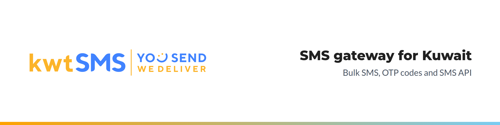

<picture>
  <source media="(prefers-color-scheme: dark)" srcset=".github/assets/readme-header-dark.png">
  
</picture>

# kwtSMS Next.js OTP login

[](https://github.com/kwtsms/kwtsms-nextjs-otp/actions/workflows/ci.yml)
[](LICENSE)

SMS one-time-code (OTP) sign in for Next.js, through kwtSMS, the Kuwaiti SMS gateway. Next.js App Router, TypeScript, [Better Auth](https://better-auth.com) phone-number plugin, English and Arabic with RTL. See the whole flow in 2 minutes with no account; go live with a few environment variables.

## About kwtSMS

kwtSMS is a Kuwaiti SMS gateway trusted by top businesses to deliver messages anywhere in the world, with private Sender ID, free API testing, non-expiring credits, and competitive flat-rate pricing. Secure, simple to integrate, built to last. Open a free account in under 1 minute, no paperwork or payment required. [Click here to get started](https://www.kwtsms.com/cportal/signup/)

## Features

- 3 screens: enter number, enter code, signed in. Plain CSS, no Tailwind or component library.
- Better Auth generates, stores and verifies the code (6 digits, valid 300 seconds, 3 attempts). This repo only sends it.
- Kuwait input: 8-digit local numbers, `+965` or `00965`, Arabic and Persian digits.
- Abuse controls on by default, counted in the database (works on Vercel): destination country allowlist (default 965, empty denies all), per-IP, per-number hourly and daily, resend cooldown, and a global daily cap that doubles as a kill switch.
- Always answers "code sent": the response never tells whether a number exists or whether the send worked. Failures go to the server log as an ERR code only.
- Three modes: **demo** (no credentials, code shown on screen), **test** (credentials, `test=1`: queued, not delivered), **live** (`KWTSMS_LIVE=1`).
- Live mode refuses to start with a short or placeholder `BETTER_AUTH_SECRET`, the shared test Sender ID, or missing credentials.

## Requirements

- Node.js 24 or newer
- For live SMS: a kwtSMS account (free test account, no papers): https://www.kwtsms.com/cportal/signup/

## Try it in 2 minutes (demo, no account)

```bash
git clone https://github.com/kwtsms/kwtsms-nextjs-otp.git
cd kwtsms-nextjs-otp
npm install
cp .env.example .env.local
npm run dev
```

Open http://localhost:3000, enter any Kuwait-style number such as `50000000`. The code is shown on the page and printed in the terminal, with the banner "Demo: no SMS sent". Nothing leaves your machine. Data goes to `./data/app.db` (SQLite, created automatically).

## Go live

1. Create a kwtSMS account and enable the API (Account > API). Note the API username and password (these are not your login).
2. Put them in `.env.local`: `KWTSMS_USERNAME`, `KWTSMS_PASSWORD`. The app is now in **test mode**: real API calls with `test=1`. Messages are queued, not delivered, and credits are held until you delete them from the Sending Queue.
3. Run the manual check: set `KWTSMS_TEST_NUMBER` to your own number (`965XXXXXXXX`) and run `npm run smoke`. It sends one `test=1` message and prints the API answer.
4. Sender ID: `KWT-SMS` is the shared test Sender ID and must not be used for real traffic. Register your own private Sender ID in your kwtSMS account; approval takes time, so start early. Set it as `KWTSMS_SENDER_ID`.
5. Set a real `BETTER_AUTH_SECRET` (`openssl rand -base64 32`) and `BETTER_AUTH_URL`.
6. Set `KWTSMS_LIVE=1`. The app now sends real SMS and spends credits.

OTP cost: 1 credit per SMS part. The English text is ASCII and fits one part (160 characters); the Arabic text fits one part (70 characters). A longer `APP_NAME` is cut to 16 characters to keep it that way. Recharge credits in your kwtSMS account.

## Deploy to Vercel

[](https://vercel.com/new/clone?repository-url=https%3A%2F%2Fgithub.com%2Fkwtsms%2Fkwtsms-nextjs-otp&env=BETTER_AUTH_SECRET,DATABASE_URL&envDescription=BETTER_AUTH_SECRET%3A%20a%20long%20random%20string.%20DATABASE_URL%3A%20a%20Postgres%20URL%20(for%20example%20Neon).)

- SQLite files do not persist on Vercel. Use Postgres (Neon from the Vercel Marketplace, for example) in `DATABASE_URL`. The tables are created at startup.
- Set `KWTSMS_IP_HEADER=x-vercel-forwarded-for` (the default). Rate limits use this header; never point it at a header the client can set.
- **Vercel preview deployments:** scope `KWTSMS_USERNAME`, `KWTSMS_PASSWORD` and `KWTSMS_LIVE` to **Production** only. Previews then run in demo mode and can never send SMS or spend credits.
- Without credentials the deployment is a public demo that shows the code on screen. Add credentials before sharing the URL.

## Use in my existing app

Copy these into your app (paths under `src/`):

| Copy | Purpose |
|---|---|
| `lib/auth.ts`, `lib/guard.ts`, `lib/db.ts` | Better Auth with the phone-number plugin, abuse guard, database |
| `lib/sms.ts`, `lib/template.ts`, `lib/errors.ts` | Send, message text, ERR log lines |
| `lib/phone.ts`, `lib/digits.ts`, `lib/limits.ts`, `lib/config.ts` | Input normalization, limits, env checks |
| `app/api/auth/[...all]/route.ts` | The Better Auth HTTP handler |
| `instrumentation.ts` | Startup checks and table creation |

Install `better-auth`, `kwtsms` and (for Postgres) `pg`. If you already use Better Auth, add two plugins to your own config: `phoneNumber({ sendOTP: makeSendOtp(cfg), ... })` and `otpGuard(cfg)`. Keep the guard: it also protects the raw `/api/auth` routes.

Better Auth creates a user on first verification (`signUpOnVerification`) with a temporary email `<digits>@phone.invalid` and the name "Phone user". To collect a real name or email, send new users to a profile page after sign in and call Better Auth's `updateUser`.

## Configuration

See `.env.example`. Main keys: `BETTER_AUTH_SECRET`, `BETTER_AUTH_URL`, `DATABASE_URL`, `KWTSMS_USERNAME`, `KWTSMS_PASSWORD`, `KWTSMS_SENDER_ID`, `KWTSMS_LIVE`, `KWTSMS_ALLOWED_COUNTRIES`, `KWTSMS_IP_HEADER`, `APP_NAME` and the `OTP_*` limits. No kwtSMS value is ever a public (`NEXT_PUBLIC_`) variable; CI fails if one appears.

## Tests

```bash
npm run lint && npx tsc --noEmit && npm test    # unit tests (vitest)
npm run build && npx playwright install chromium && npm run e2e
```

The E2E tests use an injected fake SMS client and read the code from it: no network, no credentials, no SMS. The only test that touches the real API is the manual `npm run smoke` (always `test=1`).

## Arabic

الواجهة بالعربية والإنجليزية، والعربية من اليمين إلى اليسار (RTL). رابط اللغة في أعلى الصفحة (`/ar` و `/en`).

- **تجربة بدون حساب:** `npm install` ثم انسخ `.env.example` إلى `.env.local` ثم `npm run dev`. يظهر رمز التحقق (OTP) على الصفحة مع التنبيه "تجريبي: لم تُرسل أي رسالة"، ولا تُرسل أي رسالة نصية.
- **وضع التجربة:** بعد إضافة اسم المستخدم وكلمة مرور الـ API يعمل التطبيق بوضع `test=1`: الرسالة تدخل طابور الارسال ولا تُسلّم، ويُحجز الرصيد حتى تحذفها من طابور الارسال.
- **الإرسال الفعلي:** عيّن `KWTSMS_LIVE=1` بعد تسجيل اسم المرسل (Sender ID) الخاص بك واعتماده. الاسم `KWT-SMS` للتجربة فقط.
- **التكلفة:** نقطة واحدة لكل رسالة. رسالة رمز التحقق بالإنجليزية تتسع في 160 حرفاً وبالعربية في 70 حرفاً.
- **الحماية:** السماح لدول محددة فقط (الكويت 965 افتراضياً)، وحدود لكل عنوان IP ولكل رقم، وفاصل بين إعادة الإرسال، وحد يومي عام يعمل كمفتاح إيقاف.
- **على Vercel:** حدّد متغيرات `KWTSMS_*` لبيئة الإنتاج (Production) فقط حتى لا ترسل بيئات المعاينة أي رسالة.

## FAQ

**Why do I see "code sent" even for a wrong number?** On purpose: the answer never reveals whether a number exists or whether the SMS was accepted. The reason is in the server log as an ERR code (for example `ERR003`, wrong API username or password).

**Why was my number refused?** Only countries in `KWTSMS_ALLOWED_COUNTRIES` are allowed (default `965`). Add a country code to enable it, and make sure the country is also active on your kwtSMS account (Coverage).

**Can I use my own database or auth provider?** The database is any Postgres or a SQLite file. The OTP flow is built for Better Auth; Auth.js has no SMS concept, so it is not covered here.

## Changelog

See [CHANGELOG.md](CHANGELOG.md).

## Support

- **Help:** https://www.kwtsms.com/support.html
- **FAQ:** https://www.kwtsms.com/faq/
- **Developers:** https://www.kwtsms.com/developers.html
- **API reference:** https://www.kwtsms.com/api-documentation.html
- **Issues:** https://github.com/kwtsms/kwtsms-nextjs-otp/issues

## Security

Never commit credentials. Report a vulnerability through https://www.kwtsms.com/support.html.

## License

[MIT](LICENSE), (c) kwtSMS (BoxLink Center)
